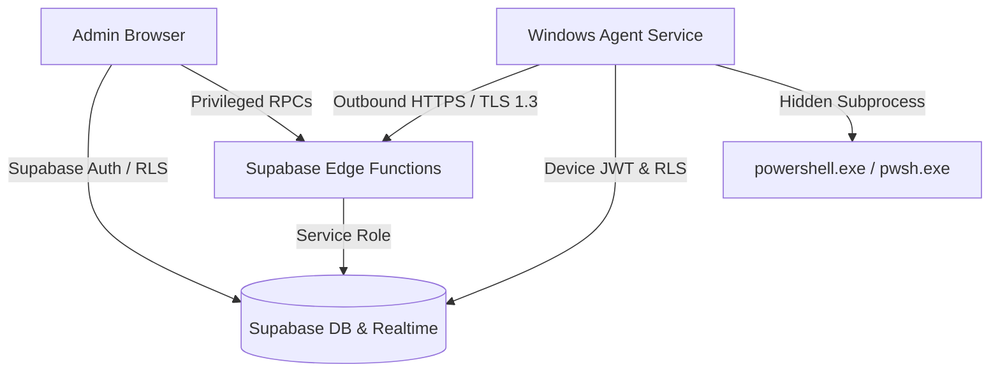

# ScriptRunner Platform — Security Policy & Threat Model

## 1. Threat Model & Security Architecture

ScriptRunner is an enterprise platform intended for authorized corporate Windows device administration. Remote script execution involves elevated privileges, making strong defense-in-depth and boundary isolation paramount.

### Trust Boundaries & Key Principles

1. **No Direct Inbound Connectivity**:
   - The Windows Agent initiates outbound TLS 1.3 / 1.2 HTTPS connections to Supabase.
   - Client computers require zero open inbound ports and no port forwarding.
2. **Strict Multi-Tenant Isolation**:
   - PostgreSQL Row Level Security (RLS) is active on every exposed table.
   - Users and agents can query data only belonging to their own verified `organization_id`.
   - Foreign key and trigger checks prevent cross-tenant device assignments.
3. **No Universal Master Key**:
   - Every enrolled device possesses its own unique 64-character cryptographic key (`api_key`).
   - Plaintext keys are never stored; only a salted SHA-256 hash and 8-character lookup prefix are stored in Supabase.
4. **Service-Role Key Protection**:
   - The Supabase `service_role` key is strictly restricted to trusted Edge Functions.
   - It is never embedded in browser JavaScript, Windows binaries, installer scripts, or git repositories.

---

## 2. Windows Service Security Model

### Least Privilege & Subprocess Isolation
- **No Interactive Desktop Window**: Background script execution uses `ProcessStartInfo` with `CreateNoWindow = true`, `UseShellExecute = false`, and `WindowStyle = Hidden`. No Command Prompt or PowerShell GUI window ever appears on the user's interactive desktop.
- **Session 0 Isolation**: The service runs as a genuine Windows Service in Session 0, isolated from logged-in interactive desktop sessions.
- **PATH Hijacking Prevention**: The execution engine does not invoke a bare `powershell` command from ambient PATH. It targets explicit system paths:
  - `C:\Program Files\PowerShell\7\pwsh.exe`
  - `%SystemRoot%\System32\WindowsPowerShell\v1.0\powershell.exe`
- **Argument-Safe File Passing**: Scripts are written to a temporary `.ps1` file rather than passed via concatenated command-line strings, avoiding argument injection vulnerabilities. The temporary file is securely removed immediately after execution in a `finally` block.
- **Process Tree Termination**: On timeout, `process.Kill(entireProcessTree: true)` terminates child processes to prevent background process leaking.

### Filesystem Anti-Tampering (NTFS ACLs)
The installer configures non-inherited NTFS permissions:
- **`%ProgramFiles%\ScriptRunnerAgent`** (Binaries):
  - `NT AUTHORITY\SYSTEM`: FullControl
  - `BUILTIN\Administrators`: FullControl
  - `BUILTIN\Users`: ReadAndExecute only (cannot overwrite binaries or inject DLLs)
- **`%ProgramData%\ScriptRunnerAgent\state`** (Local State & Config):
  - `NT AUTHORITY\SYSTEM`: FullControl
  - `BUILTIN\Administrators`: FullControl
  - `BUILTIN\Users`: No Access (denied)

### Compliance with Security Products
- ScriptRunner **does not disable** Windows Defender, Tamper Protection, SmartScreen, or audit logging.
- Antivirus, EDR, and Windows Event Logging remain active and monitor all child process activities.

---

## 3. Secret Redaction & Output Protection

Script output streams are scanned in-memory by regular expression rules prior to transmission to Supabase:
- Passwords (`password = ...`, `passwd: ...`)
- Authorization headers (`Bearer ...`)
- API keys (`api_key=...`, `token=...`)
- Supabase personal tokens (`sbp_...`)
- JWT signatures (`eyJ...`)

Redacted secrets are replaced with `[REDACTED_SECRET]`. Furthermore, output fields are bounded:
- `stdout_text`: Hard capped at 65,536 characters (64 KB). Excess output sets `stdout_truncated = true`.
- `stderr_text`: Hard capped at 16,384 characters (16 KB). Excess output sets `stderr_truncated = true`.

---

## 4. Credential Rotation & Revocation

### Enrollment Invitation Security
1. An administrator creates an invitation specifying an expiry (default: 24h, max: 72h).
2. The raw token is returned once to the admin; only the SHA-256 hash is saved in Supabase.
3. Once redeemed by the installer, `redeemed_at` is stamped atomically, preventing reuse.

### Immediate Device Revocation
- When an administrator revokes a device via the dashboard, `devices.enrollment_status` transitions to `'revoked'`.
- The database triggers and Edge Function immediately reject subsequent authentication requests and refuse job claims.
- Any in-flight token expires within 60 minutes.

### Key Rotation
To rotate an agent credential:
1. Administrator creates a new enrollment invitation.
2. Re-run `install-service.ps1 -SupabaseUrl <url> -InvitationToken <token>` on the host.
3. The host registers the new key and clears the previous state.

---

## 5. Incident Response Procedure

If a device is compromised, misplaced, or decommissioned:
1. **Immediate Revocation**: Navigate to **Dashboard > Devices > [Device]** and click **Revoke Device**. Confirm the action.
2. **Review Audit Trail**: Open **Dashboard > Settings > Append-Only Audit Stream** to inspect all jobs dispatched to that device, timestamps, and the issuing administrator.
3. **Purge Local Data**: On the host machine, run `uninstall-service.ps1` to stop the service and delete binaries and state.

---

## 6. Known Limitations

- **Power Outage Mid-Execution**: If a machine loses power while a script is executing, exactly-once execution cannot be mathematically guaranteed. On reboot, the agent identifies the interrupted job from its state file and marks it `outcome_unknown`, allowing an administrator to inspect the situation before retrying.
- **Service Account Permissions**: Background scripts execute with the privileges of the service account (`LocalSystem` by default, or an explicitly configured Managed Service Account). They do not run with the interactive user's identity.
